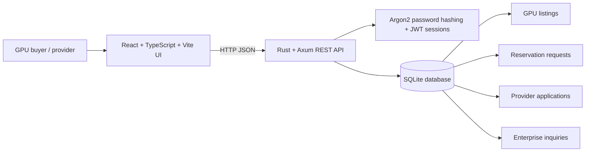

# TerveX — Technical Architecture

## System at a glance

## Components
- **Frontend:** React 19, TypeScript, Vite, Tailwind CSS. Marketplace, quote calculator, onboarding forms, account sign-in/register.
- **API:** Rust, Axum, Tokio, SQLx. REST endpoints for health, inventory, indicative quote calculations, reservation requests, provider applications, enterprise inquiries, and authentication.
- **Persistence:** SQLite. The API seeds six clearly-labelled illustrative listings on an empty database.
- **Authentication:** Argon2 password hashes and signed JWTs with a 24-hour expiry. The current browser demo stores the token in localStorage; treat this as a prototype implementation.

## Request lifecycle (current prototype)
1. A visitor filters the seeded inventory and chooses a GPU model/count/duration.
2. The quote endpoint returns spot/forward estimates using fixed demo rates.
3. The visitor submits a reservation request.
4. The API stores the request with `pending_review`. No GPU is allocated and no money is charged.

## Data classification
- `gpu_listings.is_demo = 1`: illustrative inventory.
- `/api/market-metrics`: illustrative market figures, not telemetry.
- `/api/compute/quote`: indicative fixed-rate arithmetic, not a binding quote.
- reservation and onboarding forms: persisted requests, not completed commercial transactions.

## Next architecture milestones
1. Add provider-owned listing CRUD with server-side role checks and audit events.
2. Attach each reservation to an authenticated account and add a user-owned request history endpoint.
3. Replace seeded inventory and hard-coded rates with provider integrations and timestamped availability.
4. Add a scheduler/allocator with idempotent jobs, capacity locking, failure handling and usage telemetry.
5. Integrate a payment provider and legally reviewed contract/escrow flow only after operational and compliance design.
